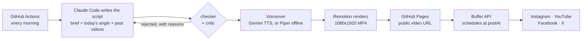

# Reel Autopilot

One short vertical video a day for your product, written, voiced, rendered and posted with no
one in the loop. Claude Code writes a small JSON script, this repo turns it into a 1080×1920 MP4,
and Buffer posts the same video to Instagram (Reel), YouTube (Short), Facebook (Reel) and X.

The worked example in `brand/` is [Random Talker](https://randomtalker.com), which has run on
it daily since November 2026. Swap `brand/` for your own product and the rest stays the same.



## How it works

- **Claude never writes code or picks pixels.** It fills in a JSON script from a fixed library
  of 14 animated scenes (hook, POV, chat, call, versus, rating, end card…), following your
  product brief and today's angle. Every day is a new idea: it sees the last 30 videos and a
  novelty check rejects repeats.
- **Quality gates.** A checker enforces the hard rules: hook at most 7 words, 25-55 spoken words,
  no claims you've banned, no AI-sounding phrases like "unlock" or "game changer", one person
  keeps one face. A second Claude call then scores hook, clarity, human tone and payoff, and
  sends weak drafts back with fixes, up to 4 attempts.
- **Voice** is one Gemini text-to-speech request per video (the free tier allows about 10 a day),
  cut into lines. If Gemini fails or is out of quota, Piper voices it locally for free.
- **Layout** keeps everything clear of the Instagram/Facebook/YouTube overlays (top bar, caption
  area, like/comment rail) without shrinking the content.
- **Hosting**: the MP4 goes to a `media` branch served by GitHub Pages (last 14 days kept), so
  Buffer can fetch it from a plain public URL.
- **Posting** goes through the Buffer API at the time you choose. The next morning's run checks
  yesterday's posts, and anything that failed opens a GitHub issue, as does any failed run.

## What it costs

| Piece | Cost |
|---|---|
| Claude | Your Claude **Pro or Max subscription**, through Claude Code. No API key, no per-token bill. A video takes about 75k tokens, mostly cached. |
| Voice | **Free**: Gemini API free tier (about 10 TTS requests a day; we use 1), falling back to Piper (open source, runs in the workflow). |
| Rendering and hosting | **Free** for a public repo: GitHub Actions (about 4 minutes a day) and GitHub Pages. A private repo uses your Actions minutes and needs a plan that includes Pages. |
| Posting | **Free**: Buffer's free plan (3 channels per account at the time of writing). For 4 networks, use two free Buffer accounts, one API key each. |
| Remotion | Free for individuals and companies of up to 3 people. Larger for-profit companies need a [Remotion company licence](https://www.remotion.dev/license). |

## Set it up

You need: a GitHub account, the [GitHub CLI](https://cli.github.com) (`gh`), Node 20+, Claude
Code with a Pro or Max plan, and a Buffer account with your social channels connected.

**1. Create your copy.** On GitHub, click **Use this template → Create a new repository**.
Make it public, so Actions minutes and Pages are free. Then:

```bash
git clone https://github.com/<you>/<your-repo>.git && cd <your-repo>
npm ci
```

**2. Give the workflow your Claude subscription.**

```bash
claude setup-token
```

It prints a long-lived token (about a year). Copy it, then:

```bash
gh secret set CLAUDE_CODE_OAUTH_TOKEN
```

Paste it at the prompt. If you pipe it in from the clipboard instead, strip the line breaks:
`pbpaste | tr -cd 'A-Za-z0-9_-' | gh secret set CLAUDE_CODE_OAUTH_TOKEN`.

**3. Optional: a better voice.** Create a free key at [Google AI Studio](https://aistudio.google.com/apikey)
in a project **without** billing (free tier), then `gh secret set GEMINI_API_KEY`. Without it,
every video is voiced by Piper.

**4. Buffer keys.** In Buffer, connect your channels, then create an API key (Settings → API).
With two Buffer accounts, make one key in each.

```bash
gh secret set BUFFER_API_KEY_1
gh secret set BUFFER_API_KEY_2   # only if you use a second Buffer account
```

**5. Turn on GitHub Pages** with GitHub Actions as the source: Settings → Pages → Build and
deployment → Source: **GitHub Actions**. Or:

```bash
gh api -X POST "repos/{owner}/{repo}/pages" -f build_type=workflow
```

Your videos will be served from `https://<owner>.github.io/<repo>/<date>.mp4`. The scripts work
this out from the repository name; set `PAGES_URL` only if you use a custom domain.

**6. Find your channel ids.** Put the same keys in a local `.env` (it's gitignored):

```bash
printf 'BUFFER_API_KEY_1=...\nBUFFER_API_KEY_2=...\n' > .env
npm run post -- --channels
```

It lists every channel each key can post to and prints a ready-made `brand/channels.json`. Keep
one entry per network you want.

**7. Make `brand/` yours.** See [Make it yours](#make-it-yours) below. Then clear the example's
history so Claude doesn't avoid Random Talker's old ideas:

```bash
rm -f reels/20*.json data/posts/*.json && echo '[]' > data/history.json
```

Preview without spending anything:

```bash
npm run stills        # every scene type in one image, platform overlays drawn in red
npm run studio        # Remotion Studio with brand/examples/sample.json
npm run make -- brand/examples/sample.json --silent   # a full silent MP4 in out/
```

Commit and push.

**8. Test run.** This writes, voices, renders and publishes one video, and marks it as a test.
Nothing is posted, because posting is still off.

```bash
gh workflow run daily.yml -f test=true
gh run watch
```

Then open `https://<owner>.github.io/<repo>/<date>.mp4`. To also test posting on a run, set
POSTING (step 9) and tick **post_now** in Actions → Daily reel → Run workflow; it schedules
the video about 5 minutes out.

**9. Go live.**

```bash
gh variable set DAILY --body on     # run every morning
gh variable set POSTING --body on   # post to Buffer
```

The schedule is in `.github/workflows/daily.yml` (`cron`, in UTC). Pick a time a few hours before
`postAt` in `brand/brand.json`, which is in your brand's timezone.

## Make it yours

Everything about the product lives in `brand/`. The code reads it from there and nowhere else.

| File | What to change |
|---|---|
| `brand/brand.json` | Name, site, hashtag, one-line pitch, audience, common words (ignored by the novelty check), timezone and posting time, colours, fonts, logo, which scene types to use, avatars, app clips, games, feature cards, and **banned claims** (regexes for things your product must never be said to do). |
| `brand/brief.md` | The facts Claude may use, what it must never claim, and your tone of voice. This decides how good and how truthful the videos are. Be specific. |
| `brand/angles.json` | 15-30 themes to rotate through (least recently used first). Each is an id and a one-line brief. |
| `brand/channels.json` | Buffer channels to post to (from `npm run post -- --channels`). |
| `brand/assets/` | Fonts, logo, avatar images, screen recordings (`clips/`), game artwork. Paths are referenced from `brand.json`. |
| `brand/examples/` | Sample scripts for previews and the Studio. |

Product-specific scenes (`match`, `call`, `chat`, `games`, `appclip`, `features`) show a calling
app. If they don't fit your product, remove them from `scenes` in `brand.json` and list the
scene types that do show it in `productScenes`, for example `["appclip"]` with your own screen
recordings. To add a new kind of scene, add it to `reel.schema.json`, `src/types.ts` and a
component in `src/scenes/`, then describe it in `prompts/craft.md`.

Not brand-specific, but worth a look: `prompts/craft.md` (hook patterns, story shape, banned
phrases), `prompts/critic.md` (the editor's rubric) and `scripts/check.ts` (hard rules).

## Day to day

| Do this | Command |
|---|---|
| Pause posting (videos are still made) | `gh variable delete POSTING` |
| Pause everything | `gh variable delete DAILY` |
| Make and post one now | Actions → Daily reel → Run workflow, tick **post_now** |
| See a day's post status | `npm run post -- 2026-11-20 --status` |
| Delete a day's scheduled posts | `npm run post -- 2026-11-20 --delete` |
| Write a script locally | `npm run write -- --date 2026-11-20` |
| Render a script locally | `npm run make -- reels/2026-11-20.json` (needs `ffmpeg`; add `--piper` or `--silent`) |

The bot commits each day's script (`reels/`), the history (`data/history.json`) and what was
scheduled (`data/posts/`) back to `main`.

## Troubleshooting

**"401 OAuth access token is invalid" / "Failed to authenticate".** The Claude token expired
(they last about a year), was revoked, or was stored with a line break. Run `claude setup-token`
again and store it with `pbpaste | tr -cd 'A-Za-z0-9_-' | gh secret set CLAUDE_CODE_OAUTH_TOKEN`.
Test it locally with `env -u ANTHROPIC_API_KEY CLAUDE_CODE_OAUTH_TOKEN="$(pbpaste)" claude -p hi`.

**"Gemini voice failed (gemini 429 …)" or "(gemini 402 …)".** 429 means the free daily quota is
used up (it resets daily); 402 means the key's Google Cloud project is on prepaid billing with no
credit, so create the key in a project without billing. Either way the video is voiced with
Piper and still goes out. Nothing to do unless you want the Gemini voice back.

**A post failed, or an issue says a channel errored.** Usually Buffer lost access to the network
(Instagram and Facebook connections expire every month or two). Reconnect the channel in Buffer;
`npm run post -- --channels` marks disconnected ones. Then re-run the day with
`npm run post -- <date>`; channels that already worked are skipped.

**"…mp4 is not serving the video".** Pages isn't on, or its source isn't GitHub Actions (step 5).
Check `https://<owner>.github.io/<repo>/` lists the videos.

**The schedule never runs.** Set `DAILY` to `on` (step 9). GitHub also pauses scheduled
workflows in repos with no commits for 60 days; the daily bot commits prevent that.

**The videos feel samey or off-brand.** Edit `brand/brief.md` and `brand/angles.json`. Those two
files decide most of what Claude writes.

## Licences

The code is MIT (see `LICENSE`). Remotion, the renderer, has its own licence: free for individuals
and companies of up to 3 people, with a paid company licence above that. Bundled assets: Sora and
Plus Jakarta Sans fonts (SIL OFL 1.1), Lorelei avatars (CC0), sound effects made for this repo
(MIT), Lucide icons (ISC). The Random Talker logo, app recordings and game artwork in `brand/`
are the worked example only and are not licensed for reuse. See `brand/ASSETS.md`.
